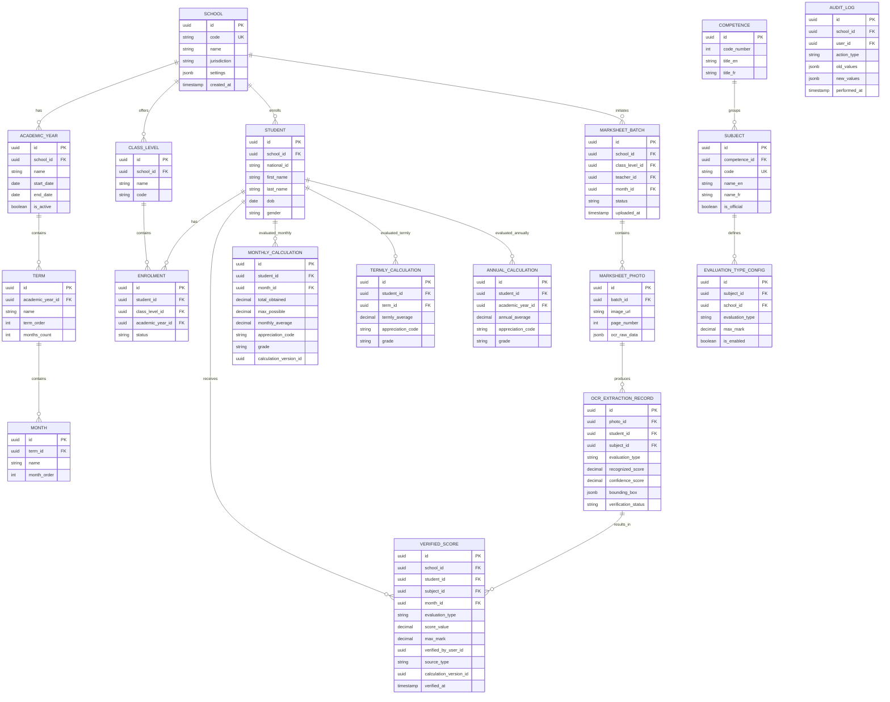

# CAMPANNETSMART1: Product Charter, Domain Model & PostgreSQL Database Architecture

## 1. Product Vision & Problem Statement

### Vision
To empower bilingual educational institutions in Cameroon and across bilingual jurisdictions with an uncompromisingly accurate, audit-ready, AI-assisted marksheet processing and report card generation engine. **CAMPANNETSMART1** marries cutting-edge OCR and layout detection with strict deterministic mathematics—guaranteeing that artificial intelligence never determines, alters, rounds, or calculates a student's grade.

### Problem Statement
Teachers in bilingual primary and secondary schools spend hundreds of hours manually transcribing handwritten marksheet matrices into report cards, prone to arithmetic errors, inconsistent weighting across evaluation types (Oral, Written, Practical, Attitude), and cumbersome translation efforts between English and French curricula (Cameroon 2018 Competency-Based Approach / Approche Par Compétences, APC). Existing software often obfuscates calculation logic inside opaque spreadsheets or AI black boxes, leading to parent disputes, audit failures, and administrative burnout. 

CAMPANNETSMART1 solves this by providing a dual-engine architecture:
1. **Marksheet Photo Calculation Engine**: Secure ingestion of marksheet photos with AI-assisted OCR, bounding box traceability, and mandatory teacher verification before any score enters calculation pipelines.
2. **Report Generation Engine**: Separate, native English and French report cards (monthly, termly, and annual) derived deterministically from verified scores without automated cross-language translation mashups.

---

## 2. User Personas & Core Jobs to Be Done

1. **Teacher (Enseignant)**
   - *Job*: Uploads classroom marksheet photos after monthly evaluations, reviews and corrects OCR extractions, and verifies student scores before calculation locking.
2. **School Administrator (Administrateur d'École)**
   - *Job*: Configures academic years, terms, class levels, subject weightings, and evaluation type maximums. Manages teacher assignments and reviews grade verification status.
3. **Verifier / Examiner (Examinateur / Vérificateur)**
   - *Job*: Inspects audit logs, resolves score correction disputes, and approves retroactive mark adjustments.
4. **Super Administrator (Super Administrateur)**
   - *Job*: Manages multi-tenant school organizations, global curriculum reference tables, system security policies, and database migrations.
5. **Parent / Guardian & Student (Parent / Élève)**
   - *Job*: Views or prints official monthly, termly, and annual report cards in native English or French with verified competency appreciations (CNA, CPA, CA, Ept).

---

## 3. End-to-End Teacher Workflow

1. **Photo Ingestion**: Teacher snaps or uploads one or multiple marksheet photos for a specific class, subject, month, and term.
2. **AI Layout & OCR Recognition**: The ingestion pipeline detects table grids, student names, IDs, evaluation columns, and handwritten scores, assigning confidence scores.
3. **Teacher Verification & Correction (Mandatory Gate)**: 
   - Unverified scores are held in staging tables.
   - The teacher reviews highlighted low-confidence cells against source photo bounding boxes.
   - The teacher corrects errors or confirms values. **No score enters the calculation engine without explicit teacher sign-off.**
4. **Deterministic Calculation**: Once verified, monthly subject totals, monthly averages, termly aggregates, and annual averages are computed deterministically.
5. **Report Card Generation**: The system instantly updates monthly, termly, and annual report cards in native English and French.
6. **Print & Archive**: The teacher or administrator prints physical copies or generates secure PDF report cards.

---

## 4. End-to-End Administrator Workflow

1. **Tenant Provisioning**: Super admin or school admin creates the school tenant profile and selects curriculum defaults (Cameroon 2018 APC).
2. **Academic Calendar Setup**: Defines the school year (e.g., 2025/2026), terms (Term 1, Term 2, Term 3), and number of evaluation months per term.
3. **Class & Subject Configuration**: Sets up class groups (e.g., CM2 / Cours Moyen 2) and configures subject evaluation types (Oral, Written mandatory; Practical, Attitude optional) with their respective maximum marks.
4. **Role Assignment**: Assigns teachers to specific classes and subjects.
5. **Audit & Oversight**: Monitors verification bottlenecks and exports official school performance summaries.

---

## 5. Entity-Relationship Diagram (Mermaid)

---

## 6. PostgreSQL-Compatible Database Schema

### 1. `schools`
- **Purpose**: Multi-tenant isolation for schools using CAMPANNETSMART1.
- **Columns**:
  - `id` UUID PRIMARY KEY DEFAULT gen_random_uuid()
  - `code` VARCHAR(50) UNIQUE NOT NULL
  - `name` VARCHAR(255) NOT NULL
  - `jurisdiction` VARCHAR(100) DEFAULT 'Cameroon (2018 APC)'
  - `settings` JSONB DEFAULT '{}'::jsonb
  - `created_at` TIMESTAMPTZ DEFAULT CURRENT_TIMESTAMP
  - `updated_at` TIMESTAMPTZ DEFAULT CURRENT_TIMESTAMP
  - `deleted_at` TIMESTAMPTZ NULL

### 2. `academic_years`
- **Purpose**: School calendar years.
- **Columns**:
  - `id` UUID PRIMARY KEY DEFAULT gen_random_uuid()
  - `school_id` UUID NOT NULL REFERENCES schools(id) ON DELETE CASCADE
  - `name` VARCHAR(50) NOT NULL (e.g., "2025/2026")
  - `start_date` DATE NOT NULL
  - `end_date` DATE NOT NULL
  - `is_active` BOOLEAN DEFAULT false
  - `created_at` TIMESTAMPTZ DEFAULT CURRENT_TIMESTAMP

### 3. `terms`
- **Purpose**: Academic terms within a school year.
- **Columns**:
  - `id` UUID PRIMARY KEY DEFAULT gen_random_uuid()
  - `academic_year_id` UUID NOT NULL REFERENCES academic_years(id) ON DELETE CASCADE
  - `name` VARCHAR(50) NOT NULL (e.g., "Term 1 / Trimestre 1")
  - `term_order` INT NOT NULL
  - `months_count` INT NOT NULL DEFAULT 3

### 4. `months`
- **Purpose**: Evaluation months within a term.
- **Columns**:
  - `id` UUID PRIMARY KEY DEFAULT gen_random_uuid()
  - `term_id` UUID NOT NULL REFERENCES terms(id) ON DELETE CASCADE
  - `name` VARCHAR(50) NOT NULL (e.g., "October")
  - `month_order` INT NOT NULL

### 5. `class_levels`
- **Purpose**: Class groups (e.g., CM2, Form 5, Class 6).
- **Columns**:
  - `id` UUID PRIMARY KEY DEFAULT gen_random_uuid()
  - `school_id` UUID NOT NULL REFERENCES schools(id) ON DELETE CASCADE
  - `name` VARCHAR(100) NOT NULL
  - `code` VARCHAR(50) NOT NULL

### 6. `students`
- **Purpose**: Student registry across the school.
- **Columns**:
  - `id` UUID PRIMARY KEY DEFAULT gen_random_uuid()
  - `school_id` UUID NOT NULL REFERENCES schools(id) ON DELETE CASCADE
  - `national_id` VARCHAR(100) NULL
  - `first_name` VARCHAR(100) NOT NULL
  - `last_name` VARCHAR(100) NOT NULL
  - `dob` DATE NULL
  - `gender` VARCHAR(10) CHECK (gender IN ('Male', 'Female', 'Other'))

### 7. `enrolments`
- **Purpose**: Links students to class levels for a given academic year.
- **Columns**:
  - `id` UUID PRIMARY KEY DEFAULT gen_random_uuid()
  - `student_id` UUID NOT NULL REFERENCES students(id) ON DELETE CASCADE
  - `class_level_id` UUID NOT NULL REFERENCES class_levels(id) ON DELETE CASCADE
  - `academic_year_id` UUID NOT NULL REFERENCES academic_years(id) ON DELETE CASCADE
  - `status` VARCHAR(50) DEFAULT 'Active'

### 8. `competences`
- **Purpose**: The 6 official APC competences.
- **Columns**:
  - `id` UUID PRIMARY KEY DEFAULT gen_random_uuid()
  - `code_number` INT UNIQUE NOT NULL
  - `title_en` VARCHAR(255) NOT NULL
  - `title_fr` VARCHAR(255) NOT NULL

### 9. `subjects`
- **Purpose**: The 10 official subjects and sub-subjects under the 6 competences.
- **Columns**:
  - `id` UUID PRIMARY KEY DEFAULT gen_random_uuid()
  - `competence_id` UUID NOT NULL REFERENCES competences(id) ON DELETE CASCADE
  - `code` VARCHAR(20) UNIQUE NOT NULL (e.g., '1A', '2A', '5', '6A1')
  - `name_en` VARCHAR(255) NOT NULL
  - `name_fr` VARCHAR(255) NOT NULL
  - `is_official` BOOLEAN DEFAULT true

### 10. `evaluation_type_configs`
- **Purpose**: Configurable max marks and enabled status for evaluation types (Oral, Written, Practical, Attitude) per subject per school.
- **Columns**:
  - `id` UUID PRIMARY KEY DEFAULT gen_random_uuid()
  - `school_id` UUID NOT NULL REFERENCES schools(id) ON DELETE CASCADE
  - `subject_id` UUID NOT NULL REFERENCES subjects(id) ON DELETE CASCADE
  - `evaluation_type` VARCHAR(30) CHECK (evaluation_type IN ('oral', 'written', 'practical', 'attitude'))
  - `max_mark` DECIMAL(5,2) NOT NULL
  - `is_enabled` BOOLEAN DEFAULT true
  - UNIQUE(school_id, subject_id, evaluation_type)

### 11. `marksheet_batches`
- **Purpose**: Tracks batch uploads of marksheet photos by teachers.
- **Columns**:
  - `id` UUID PRIMARY KEY DEFAULT gen_random_uuid()
  - `school_id` UUID NOT NULL REFERENCES schools(id) ON DELETE CASCADE
  - `class_level_id` UUID NOT NULL REFERENCES class_levels(id) ON DELETE CASCADE
  - `teacher_id` UUID NOT NULL
  - `month_id` UUID NOT NULL REFERENCES months(id) ON DELETE CASCADE
  - `status` VARCHAR(50) DEFAULT 'Uploaded'
  - `uploaded_at` TIMESTAMPTZ DEFAULT CURRENT_TIMESTAMP

### 12. `marksheet_photos`
- **Purpose**: Individual page photos belonging to a batch.
- **Columns**:
  - `id` UUID PRIMARY KEY DEFAULT gen_random_uuid()
  - `batch_id` UUID NOT NULL REFERENCES marksheet_batches(id) ON DELETE CASCADE
  - `image_url` TEXT NOT NULL
  - `page_number` INT NOT NULL
  - `ocr_raw_data` JSONB DEFAULT '{}'::jsonb

### 13. `ocr_extraction_records`
- **Purpose**: Extracted score candidates from OCR bounding boxes.
- **Columns**:
  - `id` UUID PRIMARY KEY DEFAULT gen_random_uuid()
  - `photo_id` UUID NOT NULL REFERENCES marksheet_photos(id) ON DELETE CASCADE
  - `student_id` UUID NOT NULL REFERENCES students(id) ON DELETE CASCADE
  - `subject_id` UUID NOT NULL REFERENCES subjects(id) ON DELETE CASCADE
  - `evaluation_type` VARCHAR(30) NOT NULL
  - `recognized_score` DECIMAL(5,2) NOT NULL
  - `confidence_score` DECIMAL(4,3) NOT NULL
  - `bounding_box` JSONB NOT NULL
  - `verification_status` VARCHAR(30) DEFAULT 'Pending' CHECK (verification_status IN ('Pending', 'Verified', 'Corrected', 'Rejected'))

### 14. `verified_scores`
- **Purpose**: The immutable source of truth for student scores after teacher verification.
- **Columns**:
  - `id` UUID PRIMARY KEY DEFAULT gen_random_uuid()
  - `school_id` UUID NOT NULL REFERENCES schools(id) ON DELETE CASCADE
  - `student_id` UUID NOT NULL REFERENCES students(id) ON DELETE CASCADE
  - `subject_id` UUID NOT NULL REFERENCES subjects(id) ON DELETE CASCADE
  - `month_id` UUID NOT NULL REFERENCES months(id) ON DELETE CASCADE
  - `evaluation_type` VARCHAR(30) NOT NULL
  - `score_value` DECIMAL(5,2) NOT NULL
  - `max_mark` DECIMAL(5,2) NOT NULL
  - `verified_by_user_id` UUID NOT NULL
  - `source_type` VARCHAR(50) DEFAULT 'OCR_VERIFIED'
  - `calculation_version_id` UUID NOT NULL
  - `verified_at` TIMESTAMPTZ DEFAULT CURRENT_TIMESTAMP
  - UNIQUE(student_id, subject_id, month_id, evaluation_type)
  - CHECK (score_value >= 0 AND score_value <= max_mark)

### 15. `monthly_calculations`
- **Purpose**: Materialized monthly student averages and appreciations.
- **Columns**:
  - `id` UUID PRIMARY KEY DEFAULT gen_random_uuid()
  - `student_id` UUID NOT NULL REFERENCES students(id) ON DELETE CASCADE
  - `month_id` UUID NOT NULL REFERENCES months(id) ON DELETE CASCADE
  - `total_obtained` DECIMAL(6,2) NOT NULL
  - `max_possible` DECIMAL(6,2) NOT NULL
  - `monthly_average` DECIMAL(5,2) NOT NULL
  - `appreciation_code` VARCHAR(10) NOT NULL
  - `grade` VARCHAR(5) NOT NULL
  - `calculation_version_id` UUID NOT NULL
  - `calculated_at` TIMESTAMPTZ DEFAULT CURRENT_TIMESTAMP

### 16. `termly_calculations`
- **Purpose**: Materialized termly student averages.
- **Columns**:
  - `id` UUID PRIMARY KEY DEFAULT gen_random_uuid()
  - `student_id` UUID NOT NULL REFERENCES students(id) ON DELETE CASCADE
  - `term_id` UUID NOT NULL REFERENCES terms(id) ON DELETE CASCADE
  - `termly_average` DECIMAL(5,2) NOT NULL
  - `appreciation_code` VARCHAR(10) NOT NULL
  - `grade` VARCHAR(5) NOT NULL
  - `calculated_at` TIMESTAMPTZ DEFAULT CURRENT_TIMESTAMP

### 17. `annual_calculations`
- **Purpose**: Materialized annual student averages.
- **Columns**:
  - `id` UUID PRIMARY KEY DEFAULT gen_random_uuid()
  - `student_id` UUID NOT NULL REFERENCES students(id) ON DELETE CASCADE
  - `academic_year_id` UUID NOT NULL REFERENCES academic_years(id) ON DELETE CASCADE
  - `annual_average` DECIMAL(5,2) NOT NULL
  - `appreciation_code` VARCHAR(10) NOT NULL
  - `grade` VARCHAR(5) NOT NULL
  - `calculated_at` TIMESTAMPTZ DEFAULT CURRENT_TIMESTAMP

### 18. `audit_logs`
- **Purpose**: Immutable security and verification audit trail.
- **Columns**:
  - `id` UUID PRIMARY KEY DEFAULT gen_random_uuid()
  - `school_id` UUID NOT NULL REFERENCES schools(id) ON DELETE CASCADE
  - `user_id` UUID NOT NULL
  - `action_type` VARCHAR(100) NOT NULL
  - `old_values` JSONB NULL
  - `new_values` JSONB NULL
  - `performed_at` TIMESTAMPTZ DEFAULT CURRENT_TIMESTAMP

---

## 7. Enumerations & Reference Data

- **Evaluation Types**: `oral`, `written`, `practical`, `attitude`.
- **Appreciation Codes**:
  - `0.0 – 10.99 / 20` (or `0.0 – 0.5495 / 1`): `CNA` (Competences Not Acquired / Non Acquis), Grade `C`
  - `11 – 14.99 / 20` (or `0.55 – 0.7495 / 1`): `CPA` (Competences in the Process of Acquisition / En Voie d'Acquisition), Grade `B`
  - `15 – 17.99 / 20` (or `0.75 – 0.8995 / 1`): `CA` (Competences Acquired / Acquis), Grade `A`
  - `18 – 20.0 / 20` (or `0.9 – 1.0 / 1`): `Ept` (Expert / Expert), Grade `A+`

---

## 8. Bilingual Localization Strategy

- **Separation of Concerns**: English and French are implemented as independent presentation layers with dedicated schema translation reference keys (`code`, `title_en`, `title_fr`).
- **User-Entered Content**: School names, student names, and teacher remarks are stored in their original language without auto-translation.
- **Templates**: Separate report card layouts for English ("Monthly Report Card") and French ("Bulletin Mensuel") sharing the same deterministic calculation engine output.

---

## 9. Audit, Verification & Versioning Strategy

- **Source of Truth**: No score enters calculation tables (`monthly_calculations`, `termly_calculations`) without an active record in `verified_scores`.
- **Calculation Versioning**: Each recalculation references a `calculation_version_id` UUID and algorithm timestamp to guarantee reproducibility.
- **Audit Trail**: Every verification, correction, or override is immutably logged in `audit_logs` with old and new JSON values.

---

## 10. Sample Rows Demonstration

### School
- `id`: `a0eebc99-9c0b-4ef8-bb6d-6bb9bd380a11`
- `code`: `GSB-YDE-01`
- `name`: `Groupe Scolaire Bilingue Excellence Yaoundé`

### Student
- `id`: `b1ffcc88-8d0a-3de7-aa5c-5aa8ac270b22`
- `first_name`: `Amina`
- `last_name`: `Bello`
- `national_id`: `CAM-2026-9982`

### Verified Score (Subject 1A - Communicate in English, October)
- `student_id`: `b1ffcc88-8d0a-3de7-aa5c-5aa8ac270b22`
- `subject_id`: `sub-1a-uuid`
- `evaluation_type`: `written`
- `score_value`: `14.00`
- `max_mark`: `15.00`
- `source_type`: `OCR_VERIFIED`

### Monthly Calculation
- `monthly_average`: `17.42`
- `appreciation_code`: `CA`
- `grade`: `A`

---

## 11. Database Invariants & Edge Cases

- **Invariant 1**: `score_value` can never exceed `max_mark`. Enforced via SQL `CHECK (score_value >= 0 AND score_value <= max_mark)`.
- **Invariant 2**: No report card can be generated from unverified OCR candidate scores.
- **Edge Cases Handled**:
  - *Missing student or OCR mismatch*: Held in review queue for teacher assignment.
  - *Score above maximum / negative score*: Rejected by check constraints and UI validation.
  - *Changed maximum mark*: Historical scores retain their frozen `max_mark` at verification time.
  - *Student transfer*: Enrolment records maintain historical class association per academic year.
